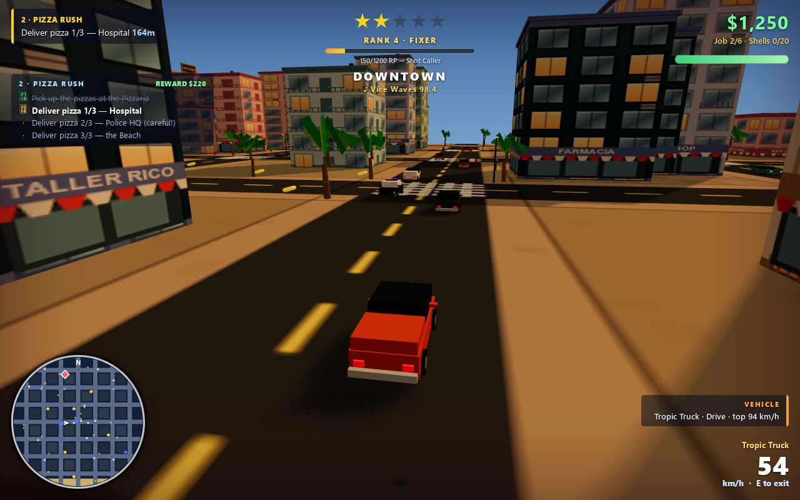
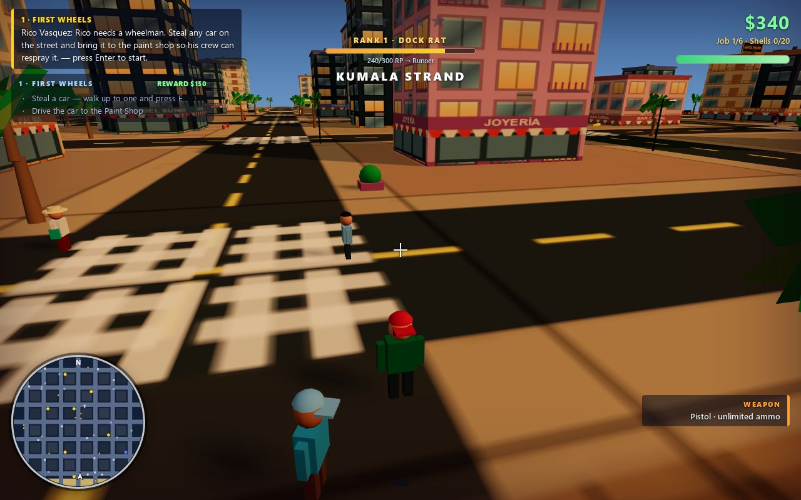
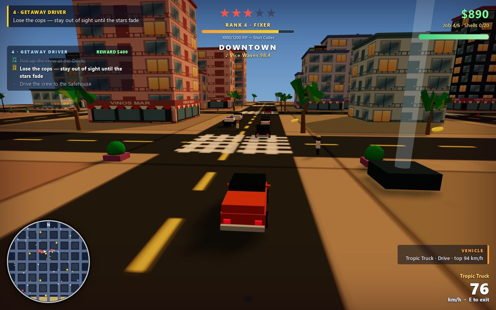
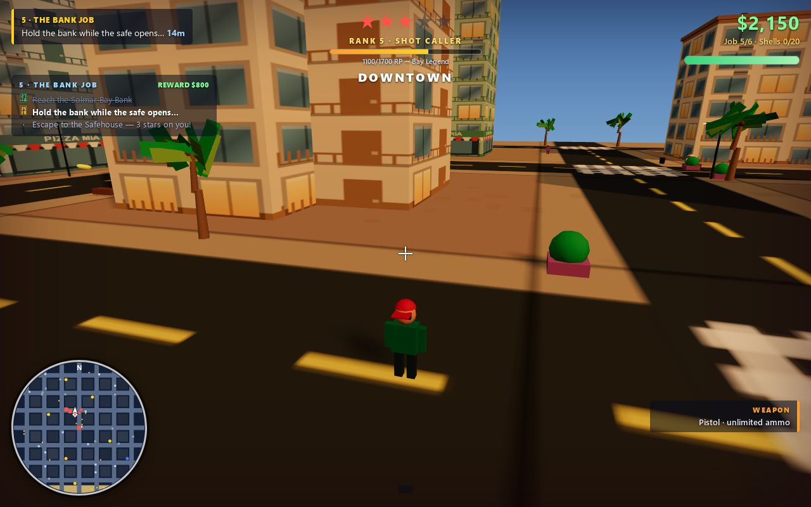

[](https://make.fun/bounty/gta6-01?utm_source=github&utm_medium=readme&utm_campaign=gta6-01)
[](https://make.fun/bounty/gta6-01/leaderboard?utm_source=github&utm_medium=readme&utm_campaign=gta6-01)
[](https://make.fun/bounty/gta6-01?utm_source=github&utm_medium=readme&utm_campaign=gta6-01)

# Solmar Bay

An open-world crime game inspired by GTA 6, built for the
[make.fun gta6-01 competition](https://make.fun/bounty/gta6-01).

You are Jay, fresh out of luck in Solmar Bay — a sun-soaked coastal city of
pastel towers, palm-lined avenues, and a beach that never sleeps. Work your
way up from petty theft to king of the bay, one job for Rico Vasquez at a
time.

## What's new in v2

A full visual and HUD pass over the v1 city — same streets, same six jobs,
same wanted system, dressed the way a GTA entry should be:

- **Painted facades** — every tower wears a canvas-painted front in one of
  three styles (art-deco pastel, glass curtain wall, seafront motel) with
  lit windows, balconies, awnings and named shopfronts at street level:
  Café Solmar, Hotel Palma, Tacos El Faro and friends.
- **Rooftops with a skyline** — parapets, AC plant, water towers and
  billboards ("Vive la Bahía") on the tall blocks.
- **A beach that reads as a beach** — wooden boardwalk, umbrella-and-towel
  pairs on the sand, a lifeguard tower, and a pier reaching into the bay.
- **Six car body styles** — sedans, hatches, pickups, vans, sports coupes
  and beach buggies, with bumpers, mirrors and grilles; cruisers get push
  bars.
- **Golden-hour light** — a gradient sunset sky, warm fog and low amber
  sun with soft shadows over the whole grid.
- **A denser street** — more palms, mid-block lamps, hydrants, bins,
  planters, 30 pedestrians with hats, bags and varied clothes, 16 traffic
  cars and 11 parked cars to steal.
- **A proper GTA HUD** — the new mission tracker lists every step of the
  current job (done / current / to come), a rank & RP bar climbs from
  Dock Rat to King of the Bay with your lifetime earnings, a district
  readout names the neighbourhood (and the radio station, while driving),
  and a side panel shows the car or weapon in hand.

## Features

- **A city to explore** — a procedurally built 7×7 grid of streets,
  sidewalks, intersections, a beach, and the ocean, with traffic,
  pedestrians, and Rico's yacht anchored offshore.
- **On foot and behind the wheel** — walk, sprint, and jump through the
  city, or steal any parked car and drive it. Traffic AI turns at
  intersections, and police cruisers patrol the streets.
- **Steal cars** — walk up to a car and press **E** to take it. Drive it,
  crash it, repaint it at the paint shop.
- **Wanted level and police** — committing crimes raises your heat (0–5
  stars). Cops chase you, ram your car, and try to bust you. Lose them,
  or pay the Fixer to bribe stars away.
- **6 story missions for Rico Vasquez** — First Wheels, Pizza Rush, Taxi
  Nights, Getaway Driver, The Bank Job, and King of the Bay — plus
  free-roam taxi fares and 20 golden shells hidden around the city
  (+$75 each).
- **Shops** — buy a pistol at Ironworks Gun Shop ($400), heal at the
  hospital ($100), repair and repaint your ride ($150).
- **HUD** — cash, health, wanted stars, mission objective and tracker,
  rank/RP bar, district + radio readout, vehicle/weapon panel,
  speedometer, and a live minimap with the city grid, the pier, cars,
  cops and mission markers.
- **Offline by design** — a fully static game. three.js is vendored
  locally, there are zero network requests, and your progress autosaves
  to localStorage every 15 seconds.

## How to play

You need [Node.js](https://nodejs.org/) 22 or newer. No build step, no
dependencies to install.

```bash
node serve.ts
```

Then open <http://localhost:8080> in your browser.

## Controls

| Input | Action |
| --- | --- |
| W / A / S / D or arrow keys | Move on foot / drive |
| Shift | Sprint (on foot) |
| Space | Jump |
| E | Steal / enter / exit a car, use a shop |
| Enter | Start the next mission |
| R | Restart the active mission |
| F | Punch |
| Left mouse click | Shoot the pistol (once bought) |
| Q | Horn (while driving) |
| Mouse drag (or click for pointer lock) | Orbit the camera |
| M | Mute / unmute sound |
| H | Hide / show the HUD |
| P or Esc | Pause |

## Tech

- [three.js](https://threejs.org/) r160, vendored under `game/vendor/` —
  no CDN, no network requests at runtime.
- Plain ES modules, no bundler, no framework.
- Synthesized WebAudio sound effects — no audio files.
- Deterministic seeded world generation (try `?seed=12345`).

## Screenshots






## Competition

Built for **make.fun gta6-01 — "Make GTA 6"**:
<https://make.fun/bounty/gta6-01>
